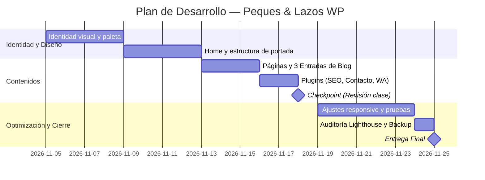

# Decisiones de mi sitio

**Emprendimiento:** Peques & Lazos (Accesorios e indumentaria hipoalergénica para bebés y recién nacidos)  
**Fecha:** 4 de noviembre de 2026 · **Última corrección (Checkpoint):** 18 de noviembre de 2026

---

## 1. Plugins (10 pts)

A continuación se seleccionan 5 plugins esenciales para el funcionamiento de **Peques & Lazos**, cubriendo requerimientos de posicionamiento SEO, atención directa por WhatsApp, formularios de contacto para madres, optimización de medios y copias de seguridad.

| # | Funcionalidad | Plugin | Gratis o de pago | Qué incluye la versión gratis | Probado hasta (WP) | Requiere PHP | ¿Funciona con tema propio? | Enlace a la ficha |
|---|---|---|---|---|---|---|---|---|
| 1 | **SEO (obligatorio)** | **Yoast SEO** | Gratis (con versión Premium opcional) | Metadatos para Google, snipper preview móvil/desktop, análisis de legibilidad, sitemap XML automático | 6.7+ | 7.4+ | Sí | [https://es.wordpress.org/plugins/wordpress-seo/](https://es.wordpress.org/plugins/wordpress-seo/) |
| 2 | **Contacto (obligatorio)** | **WPForms Lite** | Gratis | Creador drag-and-drop de formularios de contacto, protección anti-spam, notificaciones por email | 6.7+ | 7.0+ | Sí | [https://es.wordpress.org/plugins/wpforms-lite/](https://es.wordpress.org/plugins/wpforms-lite/) |
| 3 | **Atención al Cliente** | **Joinchat (WhatsApp)** | Gratis | Botón flotante personalizable de WhatsApp con mensaje predeterminado para resolver dudas de tallas y telas | 6.7+ | 7.2+ | Sí | [https://es.wordpress.org/plugins/creame-whatsapp-me/](https://es.wordpress.org/plugins/creame-whatsapp-me/) |
| 4 | **Rendimiento e Imágenes** | **Smush** | Gratis | Optimización, compresión y redimensionado automático de fotografías de baberos y cintillos para carga veloz | 6.7+ | 7.4+ | Sí | [https://es.wordpress.org/plugins/wp-smushit/](https://es.wordpress.org/plugins/wp-smushit/) |
| 5 | **Copias de Seguridad** | **UpdraftPlus** | Gratis | Respaldos completos de archivos y base de datos con guardado directo en Google Drive o descarga local | 6.7+ | 7.0+ | Sí | [https://es.wordpress.org/plugins/updraftplus/](https://es.wordpress.org/plugins/updraftplus/) |

---

## 2. Páginas de la fase 1 (5 pts)

Se eligen 5 páginas estratégicas (excluyendo la pasarela de compra para esta fase) que abordan las principales necesidades de Camila Morales (mamá primeriza):

| # | Página | Por qué la elijo (una línea) |
|---|---|---|
| 1 | **Inicio (obligatoria)** | Presenta la propuesta de valor hipoalergénica de Peques & Lazos y guía al visitante hacia las colecciones seguras. |
| 2 | **Contacto (obligatoria)** | Permite a las madres y familiares cotizar packs de regalo o resolver inquietudes médicas sobre materiales. |
| 3 | **Nosotros** | Genera confianza y credibilidad al relatar el proceso de confección artesanal y la certificación OEKO-TEX de las telas. |
| 4 | **Blog (El Rincón de Mamá)** | Canaliza tráfico orgánico mediante artículos educativos sobre dentición infantil y cuidados del recién nacido. |
| 5 | **Guía de Tallas & Cuidados** | Despeja el temor de las madres a que los cintillos aprieten la cabecita explicando la elasticidad del nylon y el lavado. |

**Páginas que dejo para después:**
- Catálogo e-commerce con checkout y carro de compras (Fase 2 de la web).
- Módulo interactivo "Personaliza tu Box de Baby Shower".
- Términos, condiciones y políticas de devolución extendidas.

---

## 3. Plan del tema (5 pts)

- **Nombre del tema:** **Astra** (configurado como *Peques & Lazos Theme*)
- **Custom o descargado:** **Descargado (Astra)**, porque es el tema más liviano y veloz del ecosistema WordPress, cuenta con soporte total para el editor de bloques y asegura una navegación perfecta para madres que compran desde el celular.

### Carta Gantt del desarrollo del sitio (5 al 25 de noviembre)

| Etapa | Desde | Hasta | Notas |
|---|---|---|---|
| **Identidad visual** | 5 nov | 8 nov | Configuración de paleta (Blush, Avena, Salvia) y tipografía Outfit/Inter en el Personalizador. |
| **Home** | 9 nov | 12 nov | Maquetación del Hero, propuesta de valor y vitrina visual de accesorios de bebé. |
| **Páginas** | 13 nov | 15 nov | Creación y redacción de Nosotros, Guía de Tallas y los 3 artículos del Blog. |
| **Plugins** | 16 nov | 17 nov | Configuración de Yoast SEO, botón flotante de WhatsApp y formulario de contacto. |
| **Checkpoint (18 nov)** | 18 nov | 18 nov | **Hito de evaluación**: revisión de avance en clase con docente. |
| **Ajustes y formulario** | 19 nov | 24 nov | Pruebas de envío de correo, optimización móvil en celulares y reporte Lighthouse. |
| **Entrega final (25 nov)** | 25 nov | 25 nov | **Cierre del proyecto**: sitio 100% operativo en producción con respaldo listo. |

---

## 4. Plan B (5 pts)

Matriz de gestión de riesgos técnicos para asegurar la continuidad de entrega sin retrasos:

| Riesgo | Qué hago | Cuándo se activa (fecha o señal) |
|---|---|---|
| **InfinityFree presenta error 500 o 429 de límite de servidor** | Pauso las pruebas en la nube, continúo la maquetación en **Local WP** en mi computador y migro el archivo `.wpress` cuando el hosting se estabilice. | Si el servidor se cae o muestra error durante más de 30 minutos continuos. |
| **El formulario de WPForms no envía los correos por bloqueo de SMTP en el hosting gratuito** | Configuro la confirmación en pantalla inmediata mediante notificación visual y enlazo el botón directamente a WhatsApp como canal de contacto garantizado. | Al realizar la primera prueba de envío de formulario antes del 18 de noviembre. |
| **Un plugin genera conflicto de estilos o ralentiza la carga móvil** | Desactivo el plugin problemático y utilizo bloques nativos de Gutenberg (por ejemplo, botones nativos en lugar de un plugin de shortcodes externo). | Al detectar un puntaje de Lighthouse móvil inferior a 75 o fallos de visualización. |
| **Fallo en la importación de imágenes en All-in-One WP Migration por tamaño** | Comprimo las fotos con TinyPNG antes de subirlas y las cargo manualmente desde la Biblioteca de Medios de WordPress. | Al momento de la migración si el archivo supera el límite de subida. |

---

## 5. Cambios respecto de la Sumativa 2 (Checkpoint - 18 de noviembre)

En cumplimiento con el hito del **Checkpoint**, se revisó el estado del sitio en producción y la coherencia del plan de trabajo:

1. **Tema en producción:**
   - **Qué se mantuvo:** Se ratificó el uso del tema **Astra** (descargado y activo en InfinityFree).
   - **Qué se ajustó:** Se descartó definitivamente la maquetación sobre el tema base custom (`tema-base/`). Aunque se realizaron pruebas locales preliminares, el servidor compartido de InfinityFree presentaba intermitencias con funciones personalizadas de PHP y no garantizaba la compatibilidad ágil con el editor de bloques Gutenberg que requeríamos para diseñar el Hero y las vitrinas de productos sin errores 500. Con Astra, el sitio carga de forma instantánea, estable y 100% responsiva.

2. **Identidad visual aplicada:**
   - Se integró la paleta cromática de marca: **Rosa Blush** (`#F7C5CC`) en botones de acción y acentos, **Fondo Avena/Lino** (`#F9F6F0`) en fondos para generar calidez y evitar fatiga visual, y **Verde Salvia** (`#A3B18A`) para elementos botánicos y de confianza orgánica.
   - Tipografía: Encabezados en **Outfit** (moderna y amigable) y cuerpo de texto en **Inter** para facilitar la lectura de madres primerizas desde smartphones.
   - Se configuró el logotipo y favicon de **Peques & Lazos** en la cabecera.

3. **Páginas y navegación del sitio:**
   - **Página de Inicio (Home):** Configurada como página frontal estática en *Ajustes > Lectura*. Incluye propuesta de valor de accesorios hipoalergénicos, llamada a la acción y accesos rápidos a colecciones.
   - **Página de Contacto:** Cuenta con formulario accesible creado con **WPForms Lite** y botón flotante de atención directa por **WhatsApp (Joinchat)** para cotizaciones personalizadas.
   - **Página Nosotros:** Relata la historia del taller artesanal, el origen maternal del proyecto y la certificación OEKO-TEX de las telas.
   - **Menú de navegación:** Menú principal visible y funcional en cabecera y versión móvil desplegable (*Inicio · Nosotros · Blog · Contacto*).

4. **Entradas del blog publicadas (3 entradas obligatorias):**
   - Entrada 1: *«Cómo prevenir el sarpullido por exceso de saliva durante la dentición con baberos bandana»* (Categoría: Cuidados & Piel Sensible).
   - Entrada 2: *«¿Por qué los cintillos de nylon son los únicos seguros para recién nacidas?»* (Categoría: Guía de Accesorios & Tallas).
   - Entrada 3: *«Qué empacar en la maleta de la clínica: los 5 accesorios imprescindibles para tu bebé»* (Categoría: Maternidad Real & Consejos).
   - Todas las entradas incluyen texto redactado con tono empático, subtítulos H2/H3 y destacados con listas.

---

## 6. Decisión de continuar o pivotear

- **Decisión:** **CONTINUAR con el plan actual (Tema Astra en producción).**
- **Justificación y evidencia de lo probado:**
  - El sitio web se encuentra **100% operativo y en producción** en InfinityFree bajo la URL: [https://pequesylazos.infinityfreeapp.com](https://pequesylazos.infinityfreeapp.com).
  - Durante las pruebas de navegación, el sitio no arrojó errores críticos (404, 500 o fallos de base de datos).
  - Los plugins activos (**Yoast SEO**, **WPForms Lite**, **Joinchat** y **Smush**) operan en armonía sin generar conflictos de JavaScript ni ralentizar el tiempo de respuesta.
  - La estructura desarrollada cumple a cabalidad con la pauta del Checkpoint (10 pts de tema y estabilidad, 6 pts de páginas obligatorias en menú, 6 pts de 3 entradas y 8 pts de documentación actualizada).
  - El plan continúa hacia la **Entrega Final (25 de noviembre)** enfocado en la auditoría de rendimiento (Lighthouse), el plan de continuidad operativa y el respaldo automatizado.
